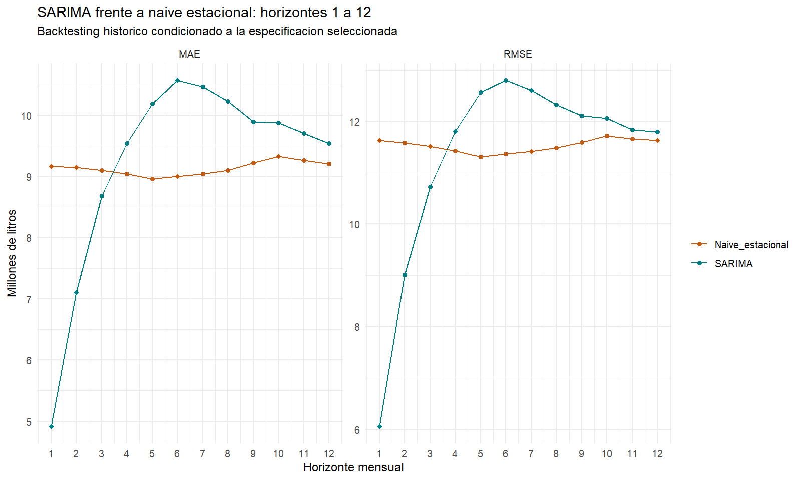

# Pronóstico mensual de la remisión de leche en Uruguay

Flujo reproducible en **R y SQL/SQLite** para preparar datos públicos del INALE, desarrollar un modelo SARIMA, evaluar sus pronósticos frente a una referencia estacional y actualizar trayectorias de doce meses mediante **GitHub Actions**.

**[Reporte actual](https://daniknd14econometrics-code.github.io/forecasting-remision-leche-uy/pronostico_actual.html)** · **[Historial de emisiones](https://daniknd14econometrics-code.github.io/forecasting-remision-leche-uy/)** · **[Seguimiento real](https://daniknd14econometrics-code.github.io/forecasting-remision-leche-uy/metricas_operativas.html)**

## Qué resuelve

La remisión mensual presenta una estacionalidad marcada y meses con distinta duración. El proyecto construye una trayectoria en litros mensuales y conserva lo que se pronosticó en cada emisión para contrastarlo después con los datos observados.

El recorrido integra descarga y conservación de originales, preparación con R, validación mediante SQL, modelización Box–Jenkins, evaluación temporal, almacenamiento de resultados y actualización automatizada. Las predicciones anteriores permanecen archivadas cuando se genera una nueva emisión.

## Resultado principal

El SARIMA obtiene menor MAE y RMSE a **1–3 meses**; el naïve estacional obtiene menores errores a **4–12 meses**. La ventaja depende del horizonte: no existe superioridad general del SARIMA.

| Horizonte | MAE SARIMA | MAE naïve estacional |
|---:|---:|---:|
| 1 mes | 4,92 | 9,16 |
| 3 meses | 8,68 | 9,10 |
| 6 meses | 10,57 | 9,00 |
| 12 meses | 9,54 | 9,20 |

MAE en millones de litros. Evaluación con 166 orígenes y horizontes 1–12, reestimando coeficientes en cada origen. **La especificación se seleccionó con datos hasta septiembre de 2025:** el backtesting es histórico y condicionado a esa especificación, no una prueba independiente del proceso completo de selección.

La operación conserva SARIMA y naïve para comparar su desempeño posterior. No se ha implementado una combinación por horizonte ni una sustitución automática del modelo basada en estos resultados.

## Datos y modelo

- **Fuente:** [remisión a planta del INALE](https://www.inale.org/estadisticas/remision-a-planta/), Uruguay.
- **Serie archivada de referencia:** enero de 2002–septiembre de 2026, 297 observaciones mensuales.
- **Desarrollo de la especificación:** enero de 2002–septiembre de 2025.
- **Transformación:** logaritmo de litros por día del mes; los pronósticos se reconvierten a litros mensuales.
- **Modelo:** SARIMA(2,1,1)(1,0,0)[12], sin deriva, con once contrastes mensuales y efectos TC de febrero de 2006 y AO de abril de 2004.
- **Referencia:** naïve estacional del promedio diario, ajustado por los días del mes objetivo.

## Operación

El script 10 consulta INALE. Si no cambian los datos y ya existe una trayectoria completa, conserva la emisión. Ante meses nuevos o revisiones de litros, reestima la misma especificación con toda la historia y registra los próximos doce meses.

El workflow prepara R y `renv`, ejecuta el script 11, recupera y guarda SQLite con sus artefactos en la rama `operacion`, y publica HTML/CSV mediante Pages. Se consulta el día 1 de cada mes a las 09:17, zona `Europe/Madrid`, y se permite ejecución manual. Los scripts 06 y 07 no se repiten en cada ciclo.

Dos ejecuciones manuales verificaron el arranque, la recuperación del estado sin duplicados y la publicación. La observación de los disparos del calendario y de las nuevas publicaciones de INALE forma parte del seguimiento operativo.

## Documentación

| Documento | Contenido |
|---|---|
| [Datos y SQL](docs/DATOS_Y_SQL.md) | Fuente, tablas, transformaciones y controles. |
| [Metodología](docs/METODOLOGIA.md) | Identificación, selección, efectos, evaluación y limitaciones. |
| [Resultados](docs/RESULTADOS.md) | Métricas completas, intervalos y artefactos. |
| [Reproducción y operación](docs/REPRODUCCION_Y_OPERACION.md) | Entorno, comandos, actualización, Actions y recuperación. |
| [Mejoras futuras](docs/MEJORAS_FUTURAS.md) | Visualización y revisión periódica del modelo, aún no implementadas. |

## Estructura

| Ruta | Función |
|---|---|
| `R/` | Ingestión, preparación, análisis y operación. |
| `sql/` | Construcción de la tabla analítica y tablas de pronósticos. |
| `data/original/` | Copias fechadas de la fuente pública. |
| `outputs/` | Evidencia del desarrollo y evaluación histórica archivada. |
| `renv.lock` | Versiones de R y dependencias. |
| `.github/workflows/` | Ejecución automática y publicación. |

La rama `main` conserva el código y la evidencia de referencia; `operacion` conserva el estado remoto actualizado. La base local no se sincroniza automáticamente con esa rama.

## Reproducción

Se utiliza R 4.6.1 y el entorno registrado en `renv.lock`. La guía de [reproducción y operación](docs/REPRODUCCION_Y_OPERACION.md) distingue la consulta de artefactos, la reconstrucción operativa y la repetición completa del análisis. Para reproducir el estudio original se utiliza el Excel archivado; una descarga actual puede contener revisiones.

## Autor

Daniel Méndez.
