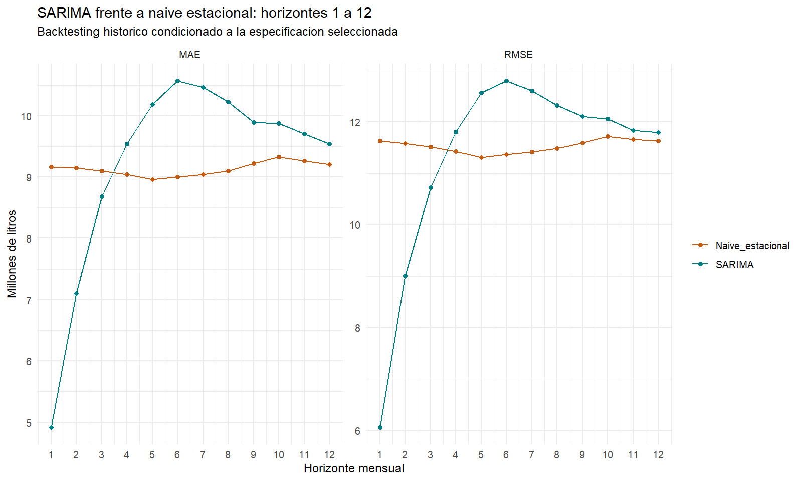
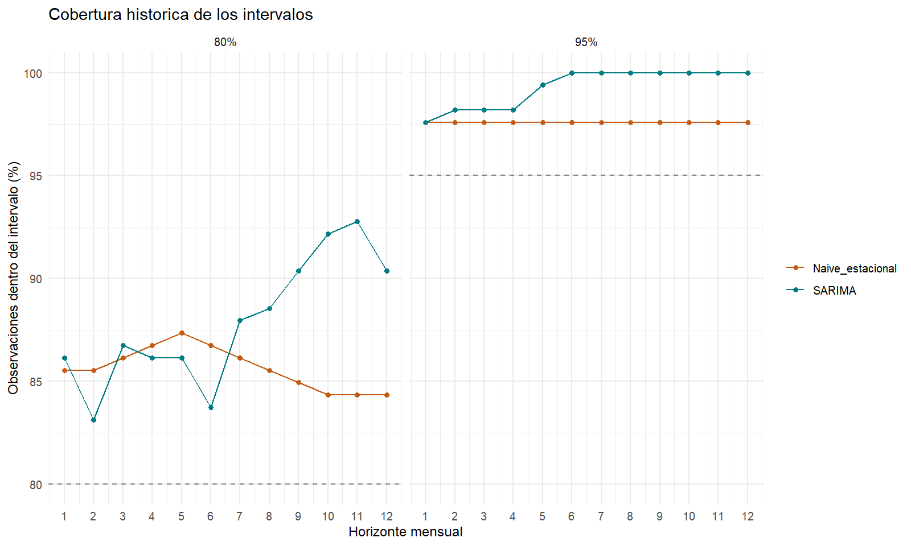
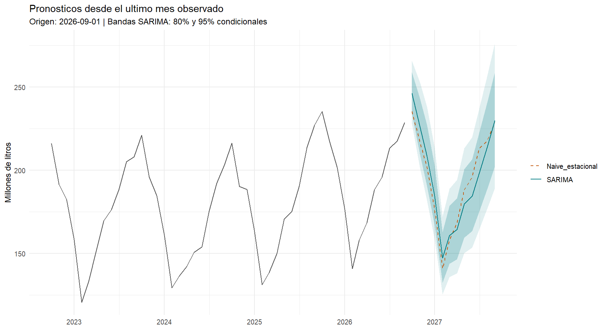

# Resultados y lectura de los pronósticos

## Evaluación histórica archivada

Corrida de referencia: `20261031_171120_23228`. Se comparan SARIMA y naïve estacional sobre 166 orígenes, con horizontes 1–12 y ventana expansiva. La evaluación es **condicionada a la especificación previamente seleccionada**; su alcance se desarrolla en [Metodología](METODOLOGIA.md).

Las métricas originales están en [el CSV por horizonte](../outputs/evaluacion_predictiva/07_sarima_vs_naive/20261031_171120_23228/03_metricas_por_horizonte.csv) y [la comparación entre modelos](../outputs/evaluacion_predictiva/07_sarima_vs_naive/20261031_171120_23228/04_comparacion_SARIMA_naive.csv).

| h (meses) | MAE SARIMA | MAE naïve | RMSE SARIMA | RMSE naïve |
|---:|---:|---:|---:|---:|
| 1 | 4,92 | 9,16 | 6,06 | 11,63 |
| 2 | 7,10 | 9,15 | 9,00 | 11,58 |
| 3 | 8,68 | 9,10 | 10,72 | 11,51 |
| 4 | 9,54 | 9,04 | 11,81 | 11,43 |
| 5 | 10,18 | 8,96 | 12,57 | 11,31 |
| 6 | 10,57 | 9,00 | 12,80 | 11,37 |
| 7 | 10,46 | 9,04 | 12,61 | 11,42 |
| 8 | 10,23 | 9,10 | 12,33 | 11,48 |
| 9 | 9,89 | 9,22 | 12,11 | 11,60 |
| 10 | 9,87 | 9,33 | 12,06 | 11,72 |
| 11 | 9,70 | 9,26 | 11,84 | 11,66 |
| 12 | 9,54 | 9,20 | 11,80 | 11,63 |

Valores en millones de litros, redondeados a dos decimales. Cada combinación de modelo y horizonte incluye 166 errores.

**SARIMA presenta menores MAE y RMSE a 1–3 meses; el naïve, a 4–12 meses.** La reducción del MAE del SARIMA es 46,35% a un mes, 22,37% a dos y 4,60% a tres. A seis meses su MAE es 17,39% mayor que el del naïve.

Estos resultados no justifican afirmar una superioridad general. La operación conserva ambas trayectorias. No se ha validado una regla híbrida que elija retrospectivamente al ganador de cada horizonte.

## Incertidumbre y diagnóstico

Las coberturas históricas superan sus niveles nominales. En SARIMA, los intervalos del 80% cubren aproximadamente 83,1%–92,8% según horizonte; los del 95%, 97,6%–100%. El naïve presenta coberturas aproximadas de 84,3%–87,3% y 97,6%, respectivamente. Las bandas SARIMA son conservadoras especialmente a horizontes largos; una cobertura mayor no basta para preferir intervalos si también aumenta mucho su ancho.

En el ajuste reestimado para emitir desde septiembre de 2026, los p-valores orientativos de Ljung–Box son 0,343, 0,199 y 0,242 en los rezagos 12, 24 y 36. Esos diagnósticos no garantizan menor error predictivo frente al benchmark.

Los desgloses por mes objetivo e interacción mes/horizonte se conservan en los CSV de la corrida. Cada celda tiene menos observaciones que el agregado por horizonte, lo que limita la estabilidad de su comparación.

## Emisión inicial de doce meses

La emisión inicial usa 297 meses hasta septiembre de 2026 y pronostica octubre de 2026–septiembre de 2027. Los valores e intervalos originales están en [el CSV de la trayectoria](../outputs/evaluacion_predictiva/07_sarima_vs_naive/20261031_171120_23228/10_pronosticos_proximos_12_meses.csv).

La figura es una emisión histórica archivada. El [reporte público vigente](https://daniknd14econometrics-code.github.io/forecasting-remision-leche-uy/pronostico_actual.html) puede actualizarse posteriormente y contiene enlaces al historial.

## Seguimiento operativo

Los reportes muestran doce meses por emisión, con media predictiva, intervalos, real, diferencia y estado. El error se define como **observado menos pronóstico**: un valor positivo significa subpredicción.

Al llegar un observado se completa el seguimiento de las emisiones que pronosticaron ese mes. Los pronósticos originales permanecen archivados. Una revisión del observado puede cambiar sus errores.

La página de [seguimiento real](https://daniknd14econometrics-code.github.io/forecasting-remision-leche-uy/metricas_operativas.html) agrega MAE/RMSE por modelo y horizonte, con la cantidad de casos evaluables. En las consultas verificadas del 1 de noviembre de 2026 todavía no había observados para evaluar la emisión inicial; los valores pendientes no significan error cero.

## Evidencia de funcionamiento remoto

| Prueba | Resultado |
|---|---|
| [Arranque inicial](https://github.com/daniknd14econometrics-code/forecasting-remision-leche-uy/actions/runs/41262543730) | Inicialización, consulta real, guardado de estado y Pages correctos; una emisión y 24 pronósticos. |
| [Recuperación posterior](https://github.com/daniknd14econometrics-code/forecasting-remision-leche-uy/actions/runs/41262927931) | Inicialización desmarcada; recuperó el estado y conservó una emisión y 24 pronósticos, sin reestimar ni duplicar. |

Las ramas con un mes nuevo simulado, revisión de datos, repetición y conservación de predicciones se probaron en un entorno temporal separado. Esas pruebas no representan una nueva publicación real de INALE ni se incorporaron al estado público. Las ejecuciones remotas verificadas fueron manuales; no se presentan como prueba del disparador mensual.
